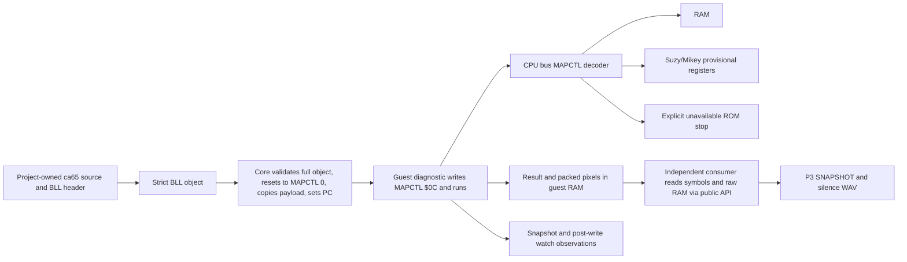

# Phase 3: Memory Map, Direct-Load Startup and First Diagnostic - Research

**Researched:** 2026-11-10  
**Domain:** Atari Lynx CPU memory map, tier-A BLL loading, diagnostic evidence and public C API consumer  
**Confidence:** HIGH for MAPCTL windows and BLL bytes measured against pinned cc65; MEDIUM for stub behavior and test decomposition; unresolved hardware behavior remains labeled.

<user_constraints>
## Upstream Phase Decisions

The following are root-selected implementation choices under the owner's existing delegation in `.planning/AUTONOMY.md`; they are not new owner decisions or approval. The full arbitration is `03-CONTEXT.md`.

- Keep O1, O5 and O6 open; profile `none` stays default. No baseline, compatibility pass, license decision, firmware use, release, emulator implementation source, or physical hardware test.
- Initialize/reset/load MAPCTL to zero. The guest diagnostic itself writes MAPCTL `$0C`; this is guest initialization, not a host-injected preset.
- Use the measured strict BS93/BLL subset. Hash the complete accepted object in the core; report body address/length separately. Remove the provisional public raw-image path and migrate runner/consumer/diagnostic setup.
- A write watch stops after the actual matching CPU write completes. Watch configuration/hit state is host observation and stays out of guest-state hashes.
- An absent mapped ROM is explicitly unavailable. Device readback, MAPCTL guest readback and hidden-RAM write-through stay provisional and source-tagged.
- Keep all 16 MAPCTL low-nibble mappings, bit 7 state, raw RAM inspection and a separate pure CPU-mapped peek. Flat5 timing remains marked PLACEHOLDER.
- Deferred: timer/IRQ and arbitration (Phase 4), page-mode calibration and display DMA/video/input (Phase 5), audio (Phase 6), and owner-gated BIOS/HLE, cartridge boot, licensing, release and hardware qualification.

</user_constraints>

<phase_requirements>
## Phase Requirements

| ID | Behavior | Research support |
|---|---|---|
| MEM-01 | MAPCTL map plus CPU-mapped and raw RAM views | Epyx window table; separate CPU decoder, raw RAM API and mapped peek; all 16 low-bit cases. |
| MEM-02 | Rights-clean tier-A direct load with sourced/reset state | Strict BLL parser; PC from payload address; MAPCTL zero at load; diagnostic writes `$0C`. |
| MEM-03 | Every run/claim records `startup=A` | Runner/bundle/manifest integration; reject missing or wrong startup tags. |
| MEM-04 | No firmware input path | BLL-only public loader; unknown/cart/ROM formats refused; absent ROM stops explicitly. |
| EVD-01 | Original diagnostic reports symbol-addressed result block | Project-owned assembly/config/header, `-Ln` symbols, result schema and negative controls. |
| API-08 | Write watch without machine behavior changes | Stop after completed matching CPU write; no-hit/boundary/rearm and continuation controls. |
| DET-03 | Snapshot restore/continue equals uninterrupted run | Serialize map/startup state, validate before apply, compare final public observations/digests. |
| HB-01 | Tick-stamped, labelled diagnostic snapshot image | Consumer renders diagnostic-owned RAM pixels as P3 PPM labelled SNAPSHOT, not a frame. |
| CON-01 | Independent public API consumer writes image and WAV | Separate target uses public header/API only; P3 image and valid silence WAV. |
</phase_requirements>

## Summary

**Primary recommendation:** Plan a single deterministic vertical slice: a strict project-authored BS93/BLL diagnostic starts at its payload address, sets MAPCTL itself, reports progress/results and pixel bytes in guest RAM, and is observed by an independent public-API consumer. The machine remains tier A; the output image is a guest-RAM snapshot, not evidence of boot, scanout, frame timing or hardware accuracy. [CONTEXT: `03-CONTEXT.md`; format corroborated by pinned cc65 measurements in `03-STARTUP-RESEARCH.md` and `03-DIAGNOSTIC-RESEARCH.md`]

The root arbitration resolves four conflicts in earlier notes: MAPCTL is zero at init/reset/load and the guest writes `$0C`; the write watch returns after its write completes; the core identity hashes the full BLL object rather than only the body; and the public raw-image startup path is removed. For missing ROM, expose an explicit unavailable path. Keep MAPCTL readback, device stubs and write-through behavior explicitly provisional. [CONTEXT: `03-CONTEXT.md`; do not reopen these choices]

## Architectural Responsibility Map

| Capability | Primary tier | Secondary tier | Rationale |
|---|---|---|---|
| CPU address decode, MAPCTL, ROM-unavailable stop | Core bus/machine | Public API inspect | Only CPU accesses use the CPU map; raw RAM remains separate. [CITED: [Epyx Hardware Addresses](https://www.monlynx.de/lynx/hardware.html)] |
| BLL parse, content identity, reset/load | Core public C API | Runner | Core validates/copies and hashes accepted object; host supplies bytes. |
| Diagnostic result/pixel data | Guest fixture | Runner/consumer | Guest proves progress; host reads raw RAM by linked symbol. |
| Watch and snapshot continuation | Core machine/API | Runner | Watch is post-write host observation; serialized guest state remains distinct. |
| PPM/WAV artifacts | Independent consumer | Public API | Host rendering/encoding stays outside deterministic core. |

## Standard Stack

| Area | Use | Reason |
|---|---|---|
| Core | Existing C17, integer-only C ABI, caller-owned machine state | Matches project policy; no allocation, host clock, filesystem or new runtime dependency. |
| Tests/build | Existing CMake preset, Ninja, CTest, exact fast inventory and `scripts/check.sh` | Reuse the one local/CI gate. |
| Diagnostic | Existing pinned cc65 `ca65`/`ld65`, original assembly and project-owned config/header | Pinned output settles the BLL subset; no CRT or emulator code in the fixture. [CITED: [cc65 Lynx docs](https://cc65.github.io/doc/lynx.html), [ld65 docs](https://cc65.github.io/doc/ld65.html)] |
| Consumer | Plain C, public header only, ASCII P3 PPM, integer PCM WAV writer | Avoid image/audio dependencies; temporary WAV output satisfies binary-artifact policy. [CONTEXT: `03-CONTEXT.md`, `03-DIAGNOSTIC-RESEARCH.md`] |

No new package or runtime service is needed. The pinned cc65 tools are available in the current pinned tree; CMake, Ninja and the C compiler are available. [VERIFIED: local availability probe 2026-11-10; toolchain setup: `scripts/check.sh`]

## Architecture Patterns

### Data flow

### Conflict resolutions for planning

| Earlier note / ambiguity | Settled implementation contract |
|---|---|
| Memory note proposed a host `$0C` preset | Init, reset and successful load use MAPCTL zero; diagnostic writes `$0C` after entry. [CONTEXT: lines 67–71] |
| Earlier watch sketch stopped before the write | Complete the matching CPU write, advance CPU/bus state, then report the watch stop. Resume must not repeat the write. [CONTEXT: lines 82–90] |
| Startup note retained body hash semantics | Hash all accepted object bytes; body address and length stay separate fields. Include format/startup/entry semantics in identity and snapshot. [CONTEXT: lines 62–66] |
| Raw image loader is convenient for runner and fixtures | Remove it from the public content path; use BLL for normal runner, consumer and diagnostic loading. A clearly private CPU-test seam may remain. [VERIFIED: `include/lynxplosion.h:141-150` — “PROVISIONAL raw RAM image loader, replaced in Phase 3.”] |
| Hardware details are not sourced | No BIOS bytes, no guessed readback/write-through/device semantics. Unavailable ROM is explicit; any stub policy is deterministic, provisional and identified as such. [CONTEXT: lines 41–49] |

### Recommended plan slices

| Slice | Deliverable and gate |
|---|---|
| 1. Bus map and inspection | Instance-owned MAPCTL decoder; MAPCTL zero on init/reset/load; all 16 low-nibble routes, every boundary, fixed FFF8/FFF9, bit 7 stored; raw RAM preserved and pure CPU-mapped peek added; absent-ROM path explicit. Flat5 stays PLACEHOLDER. |
| 2. Strict BLL API and identity | Replace public raw content startup with strict measured 10-byte BS93/BLL parser; copy payload, set PC to payload address, hash complete input object, report payload address/length, reject malformed/aliased inputs without mutation. Runner and fixture call sites migrate. |
| 3. Snapshot and watch | Bump snapshot format for map/startup/content fields, validate-before-apply. Add bounded watch that stops after completed CPU write, with exact tick/rearm/reset/load/restore rules; watch data excluded from guest-state digest. |
| 4. Original diagnostic and harness | Project-owned ca65 source/header/config and labels; result block with magic/schema/progress/error/nonzero done; guest writes MAPCTL `$0C`; parser resolves result by symbol and enforces semantic progress/time bound. |
| 5. Runner and independent consumer | Binary BLL input, `startup=A` manifest/claim and full object identity; public-API-only consumer reads result/pixels by raw RAM and emits P3 SNAPSHOT plus valid silence WAV. |
| 6. Integration evidence | Named fault controls, exact inventory and claim hash update, full `scripts/check.sh`, Linux-container/CI run on tested head, review/security fixes and critical-path timing. No CI matrix/cache expansion without distinct benefit. |

## Existing File Integration

| Existing area | Planned integration |
|---|---|
| `core/bus.c`, `core/bus.h`, `core/machine.c`, `core/internal.h`, `core/cpu.*` | Decode CPU accesses, store MAPCTL and provisional device/ROM status; keep CPU request timing seam and raw RAM path. |
| `include/lynxplosion.h`, `core/snapshot.c` | Replace provisional loader API; add mapped peek/latch/unavailable/watch observations; extend identity and snapshot, with refusal unchanged guarantees. |
| `runner/main.c`, `runner/bundle.c` | Consume strict BLL, report full-object hash plus payload metadata and `startup=A`; keep artifact fields deterministic. |
| `fixtures/`, `fixtures/manifests/`, `scripts/check-manifests.sh`, `scripts/scan-binaries.sh` | Add source/config/text representation and rights manifest for original diagnostic; no unmanifested binary fixture. |
| `tests/api/`, new memory/diagnostic/consumer test modules, `tests/tests.cmake`, `tests/inventory/fast.txt`, `cmake/Tests.cmake` | Register every test/control exactly; update existing claim inventory hash in the same change. |
| `docs/provenance.md`, `docs/policy/exposure-record.md`, `docs/claims/`, README | Record cc65 header exposure for format identification only, fixture recipe/identity/allowed use, tier and claim limits. Do not select a project licence. |

## Don't Hand-Roll / Common Pitfalls

- Use the pinned cc65 toolchain and existing SHA-256 implementation; add no image, audio, parser or runtime package.
- Do not use the raw RAM API as CPU-mapped memory, apply CPU overlays to every bus master, merge the four windows, or treat FFF8/FFF9 as ordinary overlay bytes. Test all 16 combinations. [CITED: [Epyx Hardware Addresses](https://www.monlynx.de/lynx/hardware.html)]
- Do not accept prefix/trailing/unknown BLL data, overflow, aliasing or a host-supplied hash; every refusal must preserve the full instance.
- Do not label diagnostic PPM as video/frame/scanout or silence WAV as emulated audio.
- Do not stop before the watched store; use the committed post-write state and prove rearm/continuation.
- Do not let unrun/default RAM, an invalid result block or a self-referential pixel oracle appear as PASS.

## Validation Architecture

Detailed test map and pending status are in `03-VALIDATION.md`. Phase requirements use CTest, whole-buffer refusal oracles, named mutants/controls, exact inventory, public API consumer checks and `scripts/check.sh`. Phase-specific test files/IDs do not exist yet; all planned coverage is pending. Nyquist validation is enabled in `.planning/config.json`. [VERIFIED: config workflow key; existing framework: `CMakePresets.json`, `tests/tests.cmake`, `cmake/Tests.cmake`]

## Security Domain

- **V5 Input Validation:** applies to BLL header/length/range, alias checks, symbol address parsing, watch range and snapshot fields. Validate before mutation and prove byte-identical refusal.
- **V2 Authentication / V3 Session / V4 Access Control:** not applicable; no identities, sessions or access-control service.
- **V6 Cryptography:** no cryptographic security claim. SHA-256 identifies content/state; it does not establish rights, authenticity or permission.
- Treat BLL input and symbol files as untrusted; no firmware path or external callback enters the core. [CONTEXT; `AGENTS.md` rights/evidence directives]

## Assumptions and Open Questions

| Item | Planning treatment |
|---|---|
| MAPCTL guest readback, unimplemented device values, and hidden-RAM write-through | Keep separate from the sourced decoder; any deterministic policy is provisional and tagged unverified. No model-specific claim while O1 is open. |
| Absent mapped ROM | Add an unavailable stop/status and a negative control; do not return backing RAM or fabricated BIOS. |
| Result schema, pixel pattern, watch API shape | Reversible implementation choices; define once and use independent expected constants in tests. |
| Exact timing | Retain the Phase 2 placeholder. Page-mode rule/stalls wait for later source-backed timing phases. [CITED: [Epyx CPU/ROM](https://www.monlynx.de/lynx/lynx4.html)] |

## Source Exposure and Evidence Index

- Epyx Handy specification HTML: [Hardware Addresses](https://www.monlynx.de/lynx/hardware.html), [CPU/ROM](https://www.monlynx.de/lynx/lynx4.html), [System Bus Interplay](https://www.monlynx.de/lynx/lynx11.html). The Atari Lynx Dev index links the original scan: [documentation index](https://atarilynxdev.net/doku.php/lynx:doc:start).
- Pinned-format evidence: `03-STARTUP-RESEARCH.md`, including measured probe/minimal object and cc65 header expressions; official [cc65 Lynx](https://cc65.github.io/doc/lynx.html), [ld65](https://cc65.github.io/doc/ld65.html), and [debugging](https://cc65.github.io/doc/debugging.html) docs.
- API and fixture guidance: `03-DIAGNOSTIC-RESEARCH.md`; project arbitration: `03-CONTEXT.md`; prior bus/timing interface: `.planning/phases/02-cpu-profiles-and-per-opcode-vectors/discuss/02-bus-cycle-interface.md`.
- Exposure: Epyx docs and pinned cc65 format source only. No emulator implementation source, firmware/game content, physical hardware or new package used. Add cc65 source-read purpose to the existing exposure record during implementation; O6 remains draft.

**Research date:** 2026-11-10  
**Valid until:** Recheck mutable CI/toolchain and upstream docs before a future release; hardware unknowns remain open by design.

